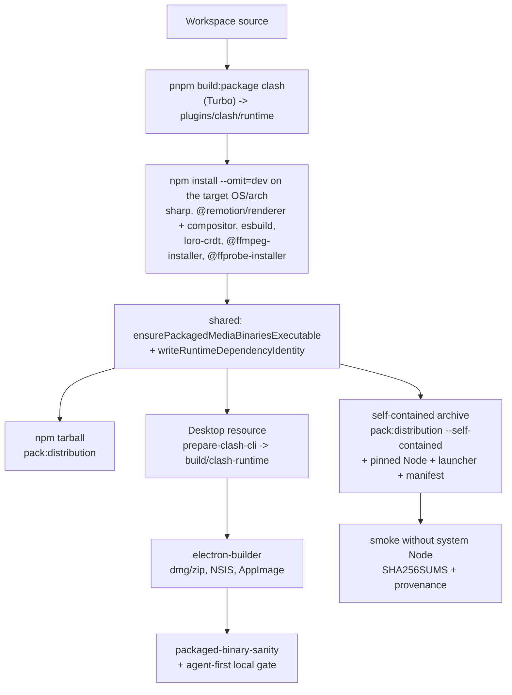

# Release Pipeline

Clash ships two products from one runtime:

1. **CLI/daemon** — the `clash` distribution in `plugins/clash` (CLI, stdio MCP, local Host).
2. **Desktop** — the Electron app in `apps/desktop`, which carries the same runtime as a resource.

This guide is the build plan for both. It states what is implemented, what is
deferred and why, and which industry practices the design follows or
deliberately departs from. Statements about other projects were checked against
the linked sources in October 2026.

Status words used below: **implemented** (code in this repository; says where it
was executed), **existing** (already in place before this plan), **deferred**
(designed, not built).

## One pipeline, two products



The shared stage is the runtime tree plus its production dependency tree for one
OS/architecture. Three packagers consume it:

| Consumer                             | Script                                       | Adds                                            | Runs on                                  |
| ------------------------------------ | -------------------------------------------- | ----------------------------------------------- | ---------------------------------------- |
| npm tarball (existing)               | `plugins/clash/scripts/pack-distribution.ts` | nothing                                         | the user's Node `>=24.18 <25`            |
| Self-contained archive (implemented) | same script, `--self-contained`              | pinned Node, `bin/clash`, `self-contained.json` | its own Node                             |
| Desktop (existing)                   | `apps/desktop/scripts/prepare-clash-cli.ts`  | flattened layout, `runtime-manifest.json`       | Electron's Node (`ELECTRON_RUN_AS_NODE`) |

All three use the same helpers in `scripts/`:
`runtime-dependency-identity.ts` (dependency-tree hash consumed by Host upgrade
detection) and `packaged-runtime-binaries.ts` (npm invocation, ffmpeg/ffprobe
platform paths and executable bits).

**Today the dependency tree is installed once per packager, not once per
platform.** Desktop and the CLI archive each run `npm install` for the same
target, with `^` ranges for `esbuild` and `yaml` and no committed lock, so the
two products can ship different dependency trees. The target state is one
`runtime-<target>` build artifact per platform that both packagers download.
That is **deferred**: it changes the Desktop packaging job, and the Desktop
first-release freeze asks for minimal change there. Until then
`runtime-dependencies.sha256` in each product records which tree it shipped, so
a mismatch is detectable.

## Decision: bundle Node rather than compile a single binary

The CLI archive is a directory archive: the official Node binary, the bundled
JavaScript, the native dependency tree and the media binaries, with a launcher
that executes the bundled Node. Two single-binary routes were tried against the
built 0.1.3 runtime on linux-x64 and rejected:

| Route                                                                                                                         | Tried                                  | Result                                                                                                                                                                                                                                                                                                                                                      |
| ----------------------------------------------------------------------------------------------------------------------------- | -------------------------------------- | ----------------------------------------------------------------------------------------------------------------------------------------------------------------------------------------------------------------------------------------------------------------------------------------------------------------------------------------------------------- |
| `bun build --compile` (Bun 1.4.2), as [pi-mono does](https://github.com/badlogic/pi-mono/blob/main/scripts/build-binaries.sh) | `runtime/dispatcher.js`                | Builds an 81 MB binary in 0.3 s that bundles 2 modules. Fails at start: `Cannot find module '/$bunfs/root/clash-cli.cjs'`. The dispatcher selects entries with `import(new URL(...))`, which the bundler cannot follow.                                                                                                                                     |
|                                                                                                                               | `runtime/clash-cli.cjs`                | Builds (84 MB). Fails at start: `Cannot find module './snippets/loro-wasm-…/inline0.js'` (loro's WASM glue).                                                                                                                                                                                                                                                |
|                                                                                                                               | `runtime/local-api.cjs`                | Does not build: `Could not resolve: "./provider-http-instrumentation.js"`.                                                                                                                                                                                                                                                                                  |
|                                                                                                                               | plain `bun runtime/dispatcher.js init` | The CLI refuses: `No Node runtime satisfying >=24.18.0 <25 was found for the Clash daemon (launcher Node 1.4.2 does not satisfy …)`. The daemon requires Node itself (it uses `node:sqlite`).                                                                                                                                                               |
| Node SEA (24.18, `--experimental-sea-config` + postject)                                                                      | `runtime/clash-cli.cjs`                | Produces a 126 MB binary. Fails at start: `ERR_UNKNOWN_BUILTIN_MODULE: No such built-in module: loro-crdt`. A SEA main script can only `require` built-ins unless everything is bundled or re-rooted with `createRequire`, and native addons must be extracted to disk first ([Node SEA docs](https://nodejs.org/api/single-executable-applications.html)). |

Both routes would still need the 230 MB native tree (sharp/libvips, the Remotion
compositor, esbuild, ffmpeg, ffprobe) beside the binary, so they would not yield
one file. Bun additionally replaces the runtime the daemon is written for.
pi-mono's Bun binary works because pi is pure JavaScript plus one WASM file
copied next to it; even so its archive is a directory, not a single file
([build-binaries.sh](https://github.com/badlogic/pi-mono/blob/main/scripts/build-binaries.sh)).
[VS Code Server](https://code.visualstudio.com/docs/remote/faq) is the closest
precedent for our shape: a per-platform server tree with a glibc floor,
downloaded and unpacked rather than compiled into one executable.

Revisit when the daemon no longer depends on dynamic entry selection and
external native packages, or when Node's SEA virtual file system (added in
v26.9) is available on the pinned Node line.

## Targets

Every target builds **natively**: `npm install` selects native optional
dependencies for the host, which is how
[esbuild](https://github.com/evanw/esbuild/blob/main/npm/esbuild/package.json)
and [sharp](https://sharp.pixelplumbing.com/install) distribute binaries. npm
can cross-install with `--os/--cpu/--libc`, but sharp's own docs call that
support "limited", and a cross-built archive could not run its smoke test.

| Target                | Runner             | Node source                      | Native deps                                                                     | ffmpeg / ffprobe                                                          | CLI archive                                             | Desktop                                 |
| --------------------- | ------------------ | -------------------------------- | ------------------------------------------------------------------------------- | ------------------------------------------------------------------------- | ------------------------------------------------------- | --------------------------------------- |
| `linux-x64` (glibc)   | `ubuntu-24.04`     | `node-v24.18.0-linux-x64.tar.gz` | all prebuilt                                                                    | `@ffmpeg-installer/linux-x64` 4.1.0, `@ffprobe-installer/linux-x64` 5.2.0 | implemented; built and smoked locally                   | existing AppImage                       |
| `linux-arm64` (glibc) | `ubuntu-24.04-arm` | `…-linux-arm64.tar.gz`           | all prebuilt (`@remotion/compositor-linux-arm64-gnu`, `@img/sharp-linux-arm64`) | `linux-arm64` 4.1.4 / 5.2.0                                               | implemented; **first run is CI**                        | none                                    |
| `darwin-arm64`        | `macos-14`         | `…-darwin-arm64.tar.gz`          | all prebuilt                                                                    | `darwin-arm64` 4.1.5 / 5.0.1                                              | implemented; **first run is CI**                        | existing dmg + zip, signed, auto-update |
| `darwin-x64`          | `macos-15-intel`   | `…-darwin-x64.tar.gz`            | all prebuilt                                                                    | `darwin-x64` 4.1.0 / 5.1.0                                                | implemented; **first run is CI**                        | existing dmg (see gap below)            |
| `win32-x64`           | `windows-latest`   | `node-v24.18.0-win-x64.zip`      | all prebuilt (`@remotion/compositor-win32-x64-msvc`)                            | `win32-x64` 4.1.0 / 5.1.0                                                 | implemented, **non-blocking** until its first green run | existing NSIS, unsigned                 |
| `win32-arm64`         | `windows-11-arm`   | zip exists and is pinned         | sharp and esbuild exist; **no Remotion compositor**                             | **no `@ffmpeg-installer` or `@ffprobe-installer` package**                | **deferred**                                            | none                                    |
| `linux-*-musl`        | —                  | no official Node binary          | compositor and sharp have musl builds                                           | installer builds are glibc-static                                         | **deferred**                                            | none                                    |

Runner labels are GitHub's
[standard hosted runners](https://docs.github.com/en/actions/reference/runners/github-hosted-runners);
`macos-13` no longer appears there, so Intel macOS uses `macos-15-intel`.

Why the deferrals:

- **win32-arm64.** Neither media installer nor the Remotion compositor publishes
  a `win32-arm64` package (checked with `npm view … optionalDependencies`).
  Shipping it needs another ffmpeg source and an emulated x64 compositor. Windows
  on ARM can run the `win32-x64` archive under emulation in the meantime.
- **musl.** There is no official musl Node binary; unofficial builds would break
  the "official binary, pinned checksum" property. `install.sh` refuses musl
  systems instead of installing something that cannot start.
- **win32-x64 is non-blocking.** No Windows machine was available when this was
  written: the `.cmd` launcher, the zip step and `install.ps1` have never run.
  The matrix entry is `experimental` (`continue-on-error`) so an untested
  platform cannot block Linux and macOS archives. Make it blocking after the
  first green run.
- **win32 Host abort on 8.3 paths.** The first `win32-x64` smoke runs died right
  after `host.listening` with `Assertion failed: !_wcsnicmp(filename, dir,
  dirlen), file src\win\fs-event.c, line 72`. That is libuv, not Clash: an
  `fs.watch` root spelled with 8.3 short names (`C:\Users\RUNNER~1\…`, the
  runner's `%TEMP%`) does not prefix the long-form names Windows reports for
  changes, and libuv asserts instead of returning an error, so the whole Host
  exits. The Host watches `CLASH_HOME` for `config.yaml` and the actions root
  under it, so any short-name home triggers it. `watchablePath`
  (`apps/local-api/src/runtime/host/lib/watch-path.ts`) now canonicalises each
  watch root with `realpathSync.native` on win32 only, falling back to the path
  as given when it cannot be resolved; other platforms pass the path through
  untouched. The smoke keeps the short temp path on Windows on purpose so this
  stays covered.
- **Chrome Headless Shell is not in the archive, by design.** It is downloaded
  once into the Clash home, as Remotion recommends, instead of adding about
  100 MB to every archive. Timeline rendering therefore stays outside the smoke
  test and outside the "no network after install" claim until the browser has
  been fetched. See [Chrome Headless Shell](#chrome-headless-shell).

## Chrome Headless Shell

Rendering (the `render-timeline` Action and the director stage renderer) needs
the Chrome Headless Shell that `@remotion/renderer` pins as `TESTED_VERSION`.
Remotion owns the version and the download; Clash only decides where it lands
and never picks a version itself.

**Why Clash has to steer the location.** Remotion's download directory is not
configurable: there is no option and no environment variable. It walks up from
`process.cwd()` to the nearest `package.json` and uses that directory's
`node_modules/.remotion` (or `<cwd>/.remotion`). In the archive that is the
installation itself, which may be read-only, and a plugin process runs with its
plugin directory as cwd. So `packages/shared-runtime/src/render-browser.ts` runs
Remotion's own `ensureBrowser()` in a child process (the bundled Node) whose cwd
is a cache directory holding a stub `package.json`, and every render passes the
result explicitly as `browserExecutable`. The Host never calls `process.chdir()`.

**Cache location.** `$CLASH_HOME/cache/browser/headless-shell-<TESTED_VERSION>/`,
with Remotion's files below `node_modules/.remotion/` and a `browser.json`
receipt naming the executable. The cached browser is used only while Remotion's
`VERSION` file there equals the installed `TESTED_VERSION`; a Remotion upgrade
that changes the pin selects a new directory and downloads again. Older
directories are not pruned automatically and can be deleted by hand.

**When it is downloaded.**

- `clash browser ensure` downloads it explicitly and prints the path, version
  and cache directory (`--json` for the same object). It exits non-zero with the
  cause when the download fails, and also when the browser is present but `ldd`
  reports unresolved shared libraries. `clash browser status` reports the same
  without downloading. Neither starts a Host, so both work in an image build.
- The Host warms it in the background a few seconds after it is ready. This is
  best-effort: failure is a single `browser.warmup_failed` record in the Host
  log (`browser.ready` on success), never a startup failure, and an in-flight
  download is aborted when the Host stops.
- A render ensures it first if it is still missing, so no render downloads into
  `node_modules`. Remotion's lock file serialises concurrent downloads.

| Variable                   | Effect                                                                                                |
| -------------------------- | ----------------------------------------------------------------------------------------------------- |
| `CLASH_BROWSER_CACHE_DIR`  | Cache root instead of `$CLASH_HOME/cache/browser` (for example a shared or pre-baked image directory) |
| `CLASH_BROWSER_EXECUTABLE` | Passed straight through as `browserExecutable`; nothing is downloaded and the version is not checked  |
| `CLASH_BROWSER_WARMUP=0`   | Disables the Host's background download; renders and `clash browser ensure` still fetch on demand     |
| `CLASH_BROWSER_GL`         | Remotion `gl` backend for Director capture instead of the probed one below (for example `angle-egl`)  |

Plugin processes do not inherit `CLASH_HOME`, so the Host forwards the resolved
cache root and `CLASH_BROWSER_EXECUTABLE` to the Remotion plugin only. The
offline smokes set `CLASH_BROWSER_WARMUP=0`.

The cache root may be a symlink (a `CLASH_HOME` on another volume): Remotion
reports the physical path of its download, and containment in the cache is
checked by real path.

### WebGL backend

Director capture renders three.js and needs a WebGL2 context. Whether a `gl`
backend can create one is only known by trying it, so the Host does not guess
from the platform or from device nodes. The first capture opens the browser with
`angle` (hardware, what a desktop has) and creates a WebGL2 context on a blank
page once. If that fails it closes the browser and reopens it with `swangle`
(ANGLE on SwiftShader, software). The browser is then reused for the Host's
lifetime, so the probe runs once; the choice is one `director.browser_gl` record
in the Host log (`reason`: `preferred`, `software-fallback` or `override`).

`CLASH_BROWSER_GL` replaces that choice. It is validated at Host startup against
the backends the installed Remotion accepts, and a value Remotion would reject
stops the Host with an error naming the variable and the accepted values. An
override is never replaced by the fallback: if its backend has no WebGL2, every
capture fails with an error naming `CLASH_BROWSER_GL` and the backend.

Checked with the pinned 149.0.7790.0 headless shell on a GPU-less x64 host and
in a `debian:bookworm-slim` container with the two libraries below: `angle`,
`angle-egl`, `egl`, `swiftshader` and `vulkan` create no WebGL2 context;
`swangle` does, and the Host falls back to it. Not checked: macOS, Windows, and
Linux with a GPU, where Remotion recommends `angle-egl`. Timeline renders set no
`gl` and keep Remotion's default.

Software rendering is slow for large frames, so two things keep a capture
bounded. The headless render loop stops drawing once the frame is published;
left running, it issues frames faster than SwiftShader finishes them, the PNG
readback waits behind the backlog, and the GPU process stays busy after the page
is closed. And the per-frame limit is one minute up to 1920×1080 and grows in
proportion to the pixel count above that (about 4.5 minutes at 4096×2304),
because rasterising on CPU threads is linear in pixels.

### Linux system libraries

The download succeeds on a bare image; launching does not. On
`debian:bookworm-slim` (x64) the headless shell Remotion serves for glibc ≥ 2.35
(149.0.7790.0 with `@remotion/renderer` 4.0.507) is missing exactly
`libnss3.so`, `libnssutil3.so`, `libnspr4.so` and `libexpat.so.1`. This is
enough to launch it and render:

```bash
apt-get update && apt-get install -y --no-install-recommends libnss3 libexpat1
```

Checked in a fresh `debian:bookworm-slim` container: `openBrowser` with
`gl: "angle"`, then `selectComposition` and an H.264 `renderMedia` of an empty
five-frame timeline. Not covered by that check:

- **Fonts.** The image has none, so text needs font packages chosen for the
  content, for example `fonts-liberation`, `fonts-noto-color-emoji`,
  `fonts-noto-cjk`.
- **`linux-arm64`**, which downloads a different binary.
- **glibc older than 2.35** (Debian 11, Ubuntu 20.04), where Remotion falls back
  to Google's build with a longer dependency list. Use Remotion's
  [Linux dependencies](https://www.remotion.dev/docs/miscellaneous/linux-dependencies)
  list there: `libnss3 libdbus-1-3 libatk1.0-0 libgbm-dev libasound2 libxrandr2
libxkbcommon-dev libxfixes3 libxcomposite1 libxdamage1 libpango-1.0-0 libcairo2
libcups2 libatk-bridge2.0-0` (`libasound2t64` on Ubuntu 24.04).

`clash browser ensure` lists whatever the loader still cannot find. Alpine/musl
is not supported by Remotion's browser builds.

## CLI archive layout

```
package/
  bin/clash                 POSIX launcher (bin\clash.cmd on Windows)
  node/bin/node             official Node 24.18.0 (node\node.exe on Windows), plus LICENSE
  runtime/                  dispatcher.js, index.js, clash-cli.cjs, local-api.cjs, agents/, …
  runtime/runtime-dependencies.sha256
  node_modules/             production dependency tree for this OS/arch
  skills/  .codex-plugin/  .mcp.json  skill-packs.json  package.json  README.md
  self-contained.json       what shipped: Node version and digests, dependency identity, media digests
```

linux-x64 0.1.3: 200 MB compressed, 509 MB unpacked, 2,117 entries (Node 119 MB,
`node_modules` 231 MB of which ffmpeg + ffprobe are 142 MB, `runtime` 160 MB).

- The root stays `package/` so the archive is a superset of the npm tarball: the
  benchmark's release extractor and `npm install <tgz>` accept it unchanged.
  Most CLIs use a versioned root directory instead; this is a **deliberate
  deviation** to avoid a second artifact format.
- The launcher uses only shell built-ins, resolves symlinks to itself, and never
  consults `PATH` for Node. A unit test runs it with `PATH=/nonexistent`.
- `.mcp.json` is rewritten to launch `./bin/clash mcp`, so a plugin cache does
  not need `node` either. On Windows it becomes `cmd.exe /d /c bin\clash.cmd mcp`;
  whether each MCP client resolves a relative command against `cwd` is
  **unverified** outside the smoke test's own spawn.
- Only `node` and its licence are taken from the Node archive. npm and corepack
  are build tools.
- Names follow Node's `process.platform`-`process.arch` (`win32-x64`), matching
  npm `os`/`cpu` and the installer packages' directories, so no mapping table is
  needed. Windows gets a `.zip`, everything else `.tgz`.

## Supply chain

| Practice                        | Reference                                                                                                                                                                                                                                                                                                                                          | Clash                                                                                                                                                                                                                                                                                                                                                                                                                                |
| ------------------------------- | -------------------------------------------------------------------------------------------------------------------------------------------------------------------------------------------------------------------------------------------------------------------------------------------------------------------------------------------------- | ------------------------------------------------------------------------------------------------------------------------------------------------------------------------------------------------------------------------------------------------------------------------------------------------------------------------------------------------------------------------------------------------------------------------------------ |
| Pin the toolchain by digest     | Node publishes `SHASUMS256.txt` per release ([verifying binaries](https://github.com/nodejs/node#verifying-binaries))                                                                                                                                                                                                                              | **implemented**: `plugins/clash/node-runtime.lock.json` pins the SHA-256 of each archive; a download or cache entry that differs is refused. **Deviation:** the pins were copied from `SHASUMS256.txt` over HTTPS; its GPG signature (`SHASUMS256.txt.asc`) was not verified. Do that when bumping Node.                                                                                                                             |
| Checksums file with the release | `SHA256SUMS` in [pi-mono](https://github.com/badlogic/pi-mono/blob/main/.github/workflows/build-binaries.yml), `SHASUMS256.txt` in Bun, `checksums.txt` in [GitHub CLI](https://github.com/cli/cli/blob/trunk/.goreleaser.yml), a signed `manifest.json` in [Claude Code](https://code.claude.com/docs/en/setup#binary-integrity-and-code-signing) | **implemented**: each job writes `<name>.SHA256SUMS` on the machine that built and smoked the archive; the `checksums` job re-verifies every archive and writes one `SHA256SUMS` covering all archives and both install scripts.                                                                                                                                                                                                     |
| Signed provenance               | [Artifact attestations](https://docs.github.com/en/actions/concepts/security/artifact-attestations) give SLSA v1.0 Build Level 2, Level 3 from a reusable workflow; GitHub CLI attests its releases with [`actions/attest`](https://github.com/cli/cli/blob/trunk/.github/workflows/deployment.yml)                                                | **implemented, not yet run**: `actions/attest@v4` over `SHA256SUMS` outside pull requests (`actions/attest-build-provenance` is now a wrapper around it). `Package CLI` is a reusable workflow, which is the Level 3 precondition. Verify with `gh attestation verify clash-…tgz --repo clash-art/clash` ([manual](https://cli.github.com/manual/gh_attestation_verify)). The repository is public, so no Enterprise plan is needed. |
| Signed checksums                | Claude Code signs its manifest with GPG; Node signs `SHASUMS256.txt`                                                                                                                                                                                                                                                                               | **deferred**: attestations already bind the checksums to this repository's workflow without a long-lived key to guard.                                                                                                                                                                                                                                                                                                               |
| Reproducible builds             | [SOURCE_DATE_EPOCH](https://reproducible-builds.org/docs/source-date-epoch/)                                                                                                                                                                                                                                                                       | **partial**: `npm pack` writes a fixed mtime and keeps modes, so equal inputs give equal bytes. Inputs are not yet equal across runs: the dependency install has no committed lock (`^` ranges). The resolved lock is published beside each archive. Committing it, and installing with `npm ci`, is the follow-up. The Windows zip carries real mtimes and is not reproducible.                                                     |
| Least-privilege CI tokens       | pi-mono sets `permissions: {}` at the top and grants per job; Codex grants `id-token` only to the jobs that sign ([pi-mono](https://github.com/badlogic/pi-mono/blob/main/.github/workflows/build-binaries.yml), [Codex](https://github.com/openai/codex/blob/main/.github/workflows/rust-release.yml))                                            | **implemented** in `package-cli.yml`: top-level `permissions: {}`; build jobs get `contents: read`; only `checksums` gets `id-token` and `attestations`; only the gated publish job gets `contents: write`. **Existing gap:** `ci.yml`, `release.yml` and `package-desktop.yml` declare no permissions and inherit the repository default.                                                                                           |
| Pin actions by commit           | pi-mono, Codex and GitHub CLI pin actions to commit SHAs                                                                                                                                                                                                                                                                                           | **deviation**: this repository pins by major tag (`actions/checkout@v7`) throughout. The new workflow follows the existing convention; pin all workflows in one change with Dependabot keeping them current.                                                                                                                                                                                                                         |
| Smoke test each artifact        | pi-mono runs `--help`, `--version` and a functional smoke on Linux, macOS and Windows runners                                                                                                                                                                                                                                                      | **implemented**: see below.                                                                                                                                                                                                                                                                                                                                                                                                          |

## Signing and notarization

|             | CLI archive                                                                                                                                                                                                                                                                                                                                                                                                                                                                                                                                                                                                                                                                                                                                                                                                                                                                                                                                                                                                                                                                                                                                                                                           | Desktop                                                                                                                                                                                                                                                                                                                                                                                                                                                      |
| ----------- | ----------------------------------------------------------------------------------------------------------------------------------------------------------------------------------------------------------------------------------------------------------------------------------------------------------------------------------------------------------------------------------------------------------------------------------------------------------------------------------------------------------------------------------------------------------------------------------------------------------------------------------------------------------------------------------------------------------------------------------------------------------------------------------------------------------------------------------------------------------------------------------------------------------------------------------------------------------------------------------------------------------------------------------------------------------------------------------------------------------------------------------------------------------------------------------------------------- | ------------------------------------------------------------------------------------------------------------------------------------------------------------------------------------------------------------------------------------------------------------------------------------------------------------------------------------------------------------------------------------------------------------------------------------------------------------ |
| **macOS**   | **Implemented, not yet run with secrets.** The archive reuses the Desktop identity and notarization setup (see below); without the secrets the bundled `node` keeps the Node.js project's signature and ffmpeg, ffprobe and the `.node`/`.dylib` files ship as npm published them. `curl`/`tar` do not set the quarantine attribute, so Gatekeeper does not assess an archive installed by `install.sh`; a browser download would be quarantined. [Apple's workflow](https://developer.apple.com/documentation/security/customizing-the-notarization-workflow) is built around `notarytool`; to our understanding a ticket cannot be stapled to a bare archive, so first launch would need network (that page did not render when checked, so confirm before relying on it). A notarized `.pkg` avoids the question, which is what [GitHub CLI](https://github.com/cli/cli/blob/trunk/.github/workflows/deployment.yml) builds. Claude Code signs and notarizes its macOS binary ([docs](https://code.claude.com/docs/en/setup#binary-integrity-and-code-signing)); Codex signs its macOS binaries and DMGs in a protected environment ([workflow](https://github.com/openai/codex/blob/main/.github/workflows/rust-release.yml)). | **Existing.** Developer ID + hardened runtime + notarization with an App Store Connect API key when the secrets are present; ad-hoc signing otherwise (`package-desktop.yml`, `run-mac-pack.ts`). `packaged-binary-sanity.ts` verifies the seal. Updates require a signed app ([electron-builder](https://github.com/electron-userland/electron-builder/blob/master/website/docs/features/auto-update.md)).                                                  |
| **Windows** | **Deferred.** No Authenticode. `node.exe` keeps the Node.js signature; `clash.cmd` is a script.                                                                                                                                                                                                                                                                                                                                                                                                                                                                                                                                                                                                                                                                                                                                                                                                                                                                                                                                                                                                                                                                                                       | **Gap (existing).** The NSIS installer is unsigned, so SmartScreen warns. Plan for both products: Azure Trusted Signing from CI, the route [GitHub CLI](https://github.com/cli/cli/blob/trunk/.github/workflows/deployment.yml) takes for its Windows binaries; EV certificates no longer bypass SmartScreen ([electron-builder](https://github.com/electron-userland/electron-builder/blob/master/website/docs/features/code-signing/code-signing-win.md)). |
| **Linux**   | Checksums and attestation only, as Claude Code does for Linux binaries.                                                                                                                                                                                                                                                                                                                                                                                                                                                                                                                                                                                                                                                                                                                                                                                                                                                                                                                                                                                                                                                                                                                               | AppImage, unsigned.                                                                                                                                                                                                                                                                                                                                                                                                                                          |

### macOS CLI archive

The darwin archives are signed with the Desktop app's Developer ID (team
`962863MJ5J`) and notarized with the same App Store Connect API key. No new
certificate or secret exists for the CLI: `package-cli.yml` reads
`MAC_CSC_LINK`, `MAC_CSC_KEY_PASSWORD` (or legacy `CSC_KEY_PASSWORD`),
`APPLE_API_KEY_BASE64`, `APPLE_API_KEY_ID` and `APPLE_API_ISSUER`, and
`release.yml` passes them with `secrets: inherit` as it does for Desktop.

- **Gate.** As in `package-desktop.yml`, signing runs only when `MAC_CSC_LINK`
  is present. Without it (fork pull requests, a repository without the secrets)
  the job prints a notice and packs unsigned binaries. `MAC_CSC_LINK` without a
  password or without the three notarization values fails the job.
- **Sign.** The job imports the certificate into a temporary keychain and
  exports `CLASH_CLI_MAC_SIGN_IDENTITY`. `pack-distribution.ts` then signs every
  Mach-O in the staged tree (`scripts/mac-codesign.ts` finds them by magic
  number, so ffmpeg, ffprobe, `*.node`, `*.dylib`, esbuild and the Remotion
  compositor are all covered) with `--options runtime --timestamp`, and the
  bundled `node` with `scripts/node.entitlements.plist`. This happens before
  `runtime-dependencies.sha256`, the `self-contained.json` digests, the archive
  and `SHA256SUMS` are written, so every recorded digest is of the signed bytes.
  `node.archive.sha256` still pins the upstream Node archive.
- **Entitlements.** `node` gets `allow-jit` and
  `allow-unsigned-executable-memory`, which V8 needs under the hardened runtime.
  `disable-library-validation` is omitted: every native module in the archive is
  signed by the same team. A Host that must load a native module signed by
  someone else would need it.
- **Notarize.** The job unpacks the packed archive, zips it with `ditto` and
  runs `xcrun notarytool submit --wait`. Notarization does not change the
  files, so the archive and its checksums stay as packed. A `.tgz` cannot carry
  a stapled ticket; Gatekeeper fetches it online on first launch.
- **Cleanup.** The keychain, the `.p8` key and the decoded certificate are
  removed in an `if: always()` step.
- **Smoke.** The smoke still runs against the final archive, after notarization.

**Unverified:** this path has not run with the real secrets. Assumptions to
confirm on its first run: `MAC_CSC_LINK` is a base64 `.p12` (electron-builder
also accepts a path or URL, which this job does not), and the two entitlements
are enough for the Host's native modules.

Windows signing stays deferred for both products: it needs a signing service
that is not configured yet, and the archive's first consumers (benchmark
sandboxes, `install.ps1`) do not pass through SmartScreen.

## Versioning and channels

|                | CLI/daemon                                                                                          | Desktop                                                                                            |
| -------------- | --------------------------------------------------------------------------------------------------- | -------------------------------------------------------------------------------------------------- |
| Version source | `plugins/clash/package.json` (0.1.3)                                                                | `apps/desktop/package.json` (0.1.0)                                                                |
| Preview        | Rolling `cli-preview` prerelease; archives keep the base version, the release notes name the commit | `X.Y.Z-preview.<run*1000+attempt>`, rolling `desktop-preview` release (`write-update-metadata.ts`) |
| Stable         | **Deferred**: `cli-vX.Y.Z` release                                                                  | `vX.Y.Z` release; `publish-desktop-stable.yml` is disabled (`if: false`)                           |
| npm            | `publish-beta.yml`, disabled: the `clash` name belongs to another project                           | —                                                                                                  |

Open decisions, recorded rather than guessed:

- The two products version independently today. A user cannot tell from
  "Desktop 0.1.0" which runtime it carries except through
  `runtime-manifest.json`. Either adopt one version for both, or surface the
  runtime version in Desktop's About panel. One version is simpler; Claude
  Code's npm package, for comparison, installs the same native binary under the
  same version.
- Preview archives of different commits share a file name. Add a
  `-preview.<build>` suffix (the Desktop scheme) once the CLI has an updater
  that compares versions.
- A stable CLI channel waits on the npm name and on signing.

Triggers (**implemented** unless noted):

| Event                                                                                                           | CLI                                                                                 | Desktop                                                                       |
| --------------------------------------------------------------------------------------------------------------- | ----------------------------------------------------------------------------------- | ----------------------------------------------------------------------------- |
| Pull request                                                                                                    | linux-x64 always; all targets when the PR touches packaging or carries `ci:package` | `ci:package` label → `package-check.yml` (existing)                           |
| Push to `master`                                                                                                | all targets, attested, workflow artifacts (14 days)                                 | all targets, workflow artifacts (existing)                                    |
| `workflow_dispatch` on Release + `CLASH_CLI_PREVIEW_PUBLICATION_ENABLED` + `cli-preview-acceptance` environment | upload to the rolling `cli-preview` release (**not yet run**)                       | `CLASH_PREVIEW_PUBLICATION_ENABLED` + `desktop-preview-acceptance` (existing) |

The CLI publish job mirrors the Desktop one: packaging is automatic,
publication needs a dispatch, a repository variable and an environment
approval. It does not move an existing `cli-preview` tag; the notes carry the
commit.

## Install, update, uninstall

**CLI (implemented; `install.sh` exercised on Linux against a local release
directory, `install.ps1` never run):**

```sh
curl -fsSL https://github.com/clash-art/clash/releases/download/cli-preview/install.sh | sh
```

```powershell
irm https://github.com/clash-art/clash/releases/download/cli-preview/install.ps1 | iex
```

`install.sh` detects the target, downloads `SHA256SUMS`, picks the archive for
the target from it, **refuses the download unless its SHA-256 matches**, unpacks
into `~/.local/share/clash/versions/<name>/`, points `current` at it and links
`~/.local/bin/clash`. That is the layout Claude Code's native installer uses
(`~/.local/bin/claude` → `~/.local/share/claude/versions/`,
[docs](https://code.claude.com/docs/en/setup#auto-updates)), and its installer
verifies a manifest checksum the same way. Bun's and Deno's install scripts
download without verifying a checksum
([bun.sh/install](https://bun.sh/install),
[deno_install](https://github.com/denoland/deno_install/blob/master/install.sh));
we follow the stricter practice.

- **Update:** run the installer again. The previous version stays on disk, so
  rolling back is re-pointing `current`. There is **no self-update** yet:
  `clash update` belongs with the component registry described in
  `plugins/clash/README.md` and is deferred.
- **Uninstall:** `sh install.sh --uninstall` (or `.\install.ps1 -Uninstall`)
  removes the versions and the launcher link. Project data under `CLASH_HOME`
  is left alone on purpose.
- **Caveat:** checksums and script come from the same release, so the checksum
  protects against corruption and a tampered mirror, not against a compromised
  release. `gh attestation verify` is the independent check.
- **Deferred:** Homebrew cask, WinGet manifest, apt/dnf repositories (Claude Code
  offers all of these; GitHub CLI builds deb and rpm), and the npm route with per-platform
  `optionalDependencies` (as [Codex](https://github.com/openai/codex/blob/main/codex-cli/bin/codex.js),
  Claude Code, esbuild and sharp do) once a package name exists.

**Desktop (existing):** download the dmg, NSIS installer or AppImage from the
release. The rolling desktop-preview release and the (still disabled) stable
workflow both publish the Linux x64 AppImage
`Clash-Desktop-Linux-x64.AppImage`, and both fail if it is missing. Only macOS
arm64 updates itself: electron-updater reads
`preview-mac.yml` or `latest-mac.yml` through a `generic` feed pointed at the
GitHub release directory and downloads the zip differentially using blockmaps
(PR #27). electron-builder's docs advise against calling `setFeedURL`; Clash
does so deliberately to serve a rolling tag as a plain directory. macOS x64,
Windows and Linux have no update feed: users reinstall. Nothing in this plan
changes that flow.

## Verification

**CLI — `plugins/clash/scripts/smoke-self-contained.ts`** imports only Node
built-ins and is executed by the archive's own Node. It checks, in order:

1. it is running on the bundled Node, whose digest matches `self-contained.json`;
2. with `--require-no-system-node`, no `node` is resolvable on `PATH`;
3. `clash --version` and `--help` through the launcher;
4. `ffmpeg -version`, `ffprobe -version`, their digests, a real encode and probe;
5. a workspace round trip across two Hosts: `init`, `assets import`,
   `workspace export`, `inspect`, `workspace import` into a second Host, `ls`,
   export again, and equal bundle digest and asset objects;
6. the stdio MCP started as `.mcp.json` declares, `initialize` and `tools/list`.

| Platform | How "no system Node" is established                                                                                                     |
| -------- | --------------------------------------------------------------------------------------------------------------------------------------- |
| Linux    | `--container debian:bookworm-slim`: a fresh container with `--network none`; `command -v node` must fail before the archive is unpacked |
| macOS    | `env -i PATH=/usr/bin:/bin:/usr/sbin:/sbin` and the bundled Node by absolute path                                                       |
| Windows  | `PATH` reduced to `System32`, bundled `node.exe` by absolute path                                                                       |

**Desktop (existing):** `packaged-binary-sanity.ts` on every platform; the
agent-first local gate (`test:e2e:agent-first-local-v1`) on macOS arm64 only;
`macos-update-e2e.yml` for the signed update path.

**Desktop gaps found while aligning (not fixed here; the freeze asks for
minimal Desktop change and none of these could be executed on this machine):**

- **macOS x64 is cross-built on an arm64 runner.** `pack:desktop:mac:x64` runs on
  `macos-latest`, and `prepare-clash-cli.ts` installs runtime dependencies with
  the host's npm, taking the architecture from `npm_config_arch ?? process.arch`.
  Nothing sets that variable, so the x64 dmg most likely carries arm64 `sharp`,
  ffmpeg, ffprobe and compositor in `clash-runtime/node_modules`. Its smoke is
  `launch` only, which would not notice. **Inferred from the scripts, not
  reproduced.** Fix: build it on `macos-15-intel`, as the CLI matrix does.
- Windows and Linux installers are unsigned and have no update feed.
- No Desktop workflow publishes checksums or provenance for installers.
- Linux arm64 and Windows arm64 Desktop builds do not exist.

## Consumers

**Desktop.** `prepare-clash-cli.ts` keeps staging the runtime itself. The shared
helpers moved to `scripts/packaged-runtime-binaries.ts` and are re-exported, so
its behaviour and tests are unchanged. Desktop does not take the bundled Node:
the Host runs under Electron with `ELECTRON_RUN_AS_NODE`.

**Benchmark (`packages/shared-artifact-evals`).**

```sh
pnpm --filter @clash/artifact-evals benchmark --suite … \
  --subject release:/path/clash-0.1.3-linux-x64.tgz --subject-sha256 <sha256> \
  --backend container --container-image <bare image> \
  --container-runner-node /path/to/node
```

- The archive digest is checked before unpacking and recorded as
  `clash.subject.artifact`. For a self-contained archive the lock also records
  `bundledRuntime`: Node version and digest, dependency-tree identity, ffmpeg and
  ffprobe digests, each re-hashed from the unpacked files.
- The Attempt's Host, CLI, MCP runtime and the runner's relay shims run on the
  bundled Node, including when the Agent harness is a compiled binary.
- `--container-runner-node` mounts one Node binary read-only for the worker, so
  the image needs only the harness. The worker's Node is runner toolchain, not
  subject; the evaluator still uses its own `ffprobe`, never the subject's.

## CI cost

Estimates, not measurements, except where marked. The repository is public, so
standard runners are [free](https://docs.github.com/en/billing/concepts/product-billing/github-actions);
the dollar column is what the same minutes cost in a private repository at
[list price](https://docs.github.com/en/billing/reference/actions-runner-pricing).

| Job                                                   | Est. minutes | Rate         | Private-repo cost |
| ----------------------------------------------------- | ------------ | ------------ | ----------------- |
| CLI linux-x64                                         | 12           | $0.006       | $0.07             |
| CLI linux-arm64                                       | 12           | $0.005       | $0.06             |
| CLI darwin-arm64                                      | 15           | $0.062       | $0.93             |
| CLI darwin-x64                                        | 18           | $0.062       | $1.12             |
| CLI win32-x64                                         | 20           | $0.010       | $0.20             |
| checksums + attest                                    | 2            | $0.006       | $0.01             |
| **Full CLI matrix**                                   | **~80**      |              | **~$2.40**        |
| Ordinary pull request (linux-x64 only)                | ~14          |              | ~$0.08            |
| Desktop matrix (existing, 4 jobs, 45-minute cap each) | 60–120       | mostly macOS | $3–6              |

Measured locally on 8 cores with a warm Turbo cache: packing takes 38 s and the
container smoke 18 s. The CI estimates are dominated by dependency installation
and the uncached runtime build.

Storage: one full CLI run uploads about 1 GB (five archives of roughly 200 MB),
kept 14 days. Artifact storage beyond the plan allowance is $0.25 per GB-month,
so each retained run costs about $0.12; twenty master pushes a month is about
$2.30. Release assets on GitHub Releases are not billed as Actions storage.

## Deferred, in priority order

1. Run the matrix once; make `win32-x64` blocking or fix what the first run shows.
2. Build macOS x64 Desktop natively.
3. Commit the runtime dependency lock and install with `npm ci`; build the
   dependency tree once per target and share it between both packagers.
4. Run the macOS CLI signing path once with the real secrets; Windows signing for both.
5. Declare `permissions:` in the existing workflows; pin actions by SHA.
6. Stable CLI channel, version suffix for previews, and `clash update`.
7. Homebrew, WinGet, apt/dnf; npm with per-platform packages once a name exists.
8. `win32-arm64`; musl. (Remotion has no Chrome Headless Shell for either.)
9. Prune browser cache directories left behind by older Remotion pins; exercise a
   render in the Linux smoke once an image with the libraries above is used.
